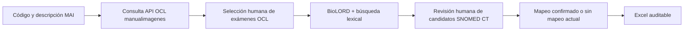

# Guía de instalación y uso local

## Mapeo asistido MAI → OCL manualimagenes → SNOMED CT

Esta guía explica cómo instalar la herramienta en un computador local, cargar una edición RF2 de
SNOMED CT, habilitar la desambiguación de prestaciones de imagenología mediante Open Concept Lab
(OCL) y realizar una revisión trazable de los mapeos antes de exportarlos a Excel.

La aplicación es una herramienta de **apoyo al mapeo terminológico**. BioLORD, el reordenador y el
LLM proponen candidatos; la decisión final debe ser tomada por una persona con competencias clínicas
y terminológicas. No reemplaza la validación clínica ni convierte automáticamente una prestación
administrativa MAI en un concepto SNOMED CT equivalente.

## 1. Qué problema resuelve

Una prestación MAI puede ser más amplia que un examen clínico único. Por ejemplo, su descripción
puede contener distintas proyecciones, lateralidades o procedimientos alternativos. Buscar SNOMED CT
directamente con ese texto completo puede mezclar métodos o sitios anatómicos.

La herramienta separa el trabajo en dos decisiones:

1. **Desambiguación:** identificar en `MINSALQA/manualimagenes` los exámenes individuales que están
   comprendidos en la prestación MAI.
2. **Mapeo:** buscar y validar uno o más conceptos SNOMED CT para cada examen OCL seleccionado.



El resultado puede servir como insumo para un servicio terminológico o un `ConceptMap` FHIR. No
debe interpretarse automáticamente como una regla de facturación ni como equivalencia bidireccional:
las relaciones MAI–SNOMED CT pueden ser 1:1, 1:N, más amplias, más específicas o solamente
relacionadas.

## 2. Componentes locales y conexiones externas

| Componente | Ubicación | Función |
|---|---|---|
| PostgreSQL 16 + pgvector | Docker local | Descripciones SNOMED CT, jerarquía, vectores, caché OCL y selección de componentes |
| API FastAPI | Proceso Python local | Búsqueda, consulta OCL, persistencia y generación de Excel |
| BioLORD-2023-M | Modelo local | Embeddings biomédicos multilingües y recuperación semántica |
| BGE reranker | Modelo local opcional | Reordena candidatos recuperados |
| Gemma mediante Ollama | Modelo local opcional | Preprocesamiento y selección contextual (`LLM pick`) |
| OCL API | Servicio externo | Busca exámenes únicos en `MINSALQA/manualimagenes` |
| Navegador | Local | Interfaz y almacenamiento de la revisión detallada |

Una vez descargados los modelos y cargado el RF2, la búsqueda SNOMED CT funciona localmente. La
desambiguación OCL sí requiere acceso a `https://api.openconceptlab.org` cuando una consulta no está
en el caché local.

## 3. Requisitos

- Git.
- Docker Desktop o Docker Engine con Compose v2.
- Python 3.10 o superior.
- GNU Make.
- Una distribución RF2 `Snapshot` de SNOMED CT International.
- Opcional pero recomendado: la distribución de idioma español de SNOMED CT.
- Licencia vigente para utilizar SNOMED CT y, cuando corresponda, UMLS/BioLORD.
- Espacio suficiente para el RF2, los modelos, los embeddings y los índices. El volumen final depende
  de las ediciones cargadas; conviene reservar varias decenas de GB.
- Para aceleración: Apple Silicon (`mps`) o GPU NVIDIA (`cuda`). También funciona con CPU, con una
  carga inicial bastante más lenta.

Sistemas recomendados:

- macOS: Terminal + Docker Desktop; Homebrew facilita la instalación de Python, Make y Ollama.
- Linux: Docker Engine, Python y Make nativos.
- Windows: WSL2 con Docker Desktop integrado. Ejecutar todos los comandos dentro de WSL2.

## 4. Obtener el código

```bash
git clone https://github.com/alopezo/snomed-hybrid-search.git
cd snomed-hybrid-search
```

Si la funcionalidad MAI/OCL todavía se encuentra en una rama y no en `main`, cambiar a la versión
documentada:

```bash
git fetch --all --tags
git switch feature/ocl-mai-decomposition-v2
```

Para conservar una versión estable antes de actualizar:

```bash
git describe --tags --always
git switch -c respaldo-local
```

## 5. Preparar los RF2

Los archivos RF2 **no se incluyen en GitHub**. Deben ser obtenidos y utilizados de acuerdo con la
licencia de SNOMED International o del NRC correspondiente.

Descomprimir las distribuciones sin cambiar su estructura. Se necesitan las carpetas `Snapshot`, por
ejemplo:

```text
/terminologias/SnomedCT_InternationalRF2_PRODUCTION_YYYYMMDD.../Snapshot
/terminologias/SnomedCT_SpanishRelease-es_PRODUCTION_YYYYMMDD.../Snapshot
```

La edición International aporta los conceptos y la jerarquía. La distribución española aporta las
descripciones traducidas y el refset de idioma. Esta herramienta utiliza:

- módulo de descripciones españolas: `450829007`;
- refset de idioma español: `450828004`.

## 6. Configurar `.env`

```bash
cp .env.example .env
```

Editar al menos:

```dotenv
SNOMED_SNAPSHOT_DIR=/ruta/absoluta/al/International/Snapshot
DISPLAY_LANGUAGE_MODULE=450829007
EMBED_DEVICE=cpu
```

Usar `mps` en un Mac Apple Silicon o `cuda` con una configuración NVIDIA compatible.

### Descarga inicial de modelos

En un equipo con acceso a Hugging Face:

```dotenv
HF_HUB_OFFLINE=0
TRANSFORMERS_OFFLINE=0
```

Después de descargar y validar los modelos, se pueden cambiar ambos valores a `1` para trabajar sin
conexión. Si Hugging Face está bloqueado, copie previamente los directorios de los modelos desde un
equipo autorizado y configure `EMBED_MODEL` y `RERANK_MODEL` con rutas absolutas locales.

## 7. Instalar y cargar SNOMED CT

### Alternativa A: edición International solamente

```bash
make all
```

El comando crea el entorno virtual, levanta PostgreSQL, carga RF2, construye la jerarquía, descarga
BioLORD, calcula embeddings y crea los índices.

### Alternativa B: International + español

Esta es la alternativa recomendada para mostrar términos preferidos en español:

```bash
make db-up install
make etl hierarchy index-lexical
make load-spanish \
  ES=/ruta/absoluta/al/SpanishRelease/Snapshot \
  INTL=/ruta/absoluta/al/InternationalRF2/Snapshot
make index-hnsw
```

También se puede añadir español a una instalación International ya indexada:

```bash
make load-spanish \
  ES=/ruta/absoluta/al/SpanishRelease/Snapshot \
  INTL=/ruta/absoluta/al/InternationalRF2/Snapshot
```

El proceso no copia el RF2 al repositorio. Lee sus archivos desde la ruta configurada y carga el
contenido necesario en el volumen local de PostgreSQL.

## 8. Configurar OCL manualimagenes

Crear una cuenta o utilizar una cuenta autorizada para consultar la fuente. La documentación oficial
de OCL explica la autenticación por token y la búsqueda paginada:

- <https://docs.openconceptlab.org/en/latest/oclapi/overview.html>
- <https://docs.openconceptlab.org/en/latest/oclapi/apireference/concepts.html>

Agregar al archivo `.env`:

```dotenv
OCL_API_URL=https://api.openconceptlab.org
OCL_ORG=MINSALQA
OCL_SOURCE=manualimagenes
OCL_USER=usuario-ocl
OCL_TOKEN=token-personal
OCL_MAI_DECOMPOSITION_ENABLED=true
```

Reglas de seguridad:

- No escribir el token en el código, el README, capturas o archivos Excel.
- No subir `.env` a GitHub. Ya está excluido mediante `.gitignore`.
- El token permanece en el backend; la interfaz recibe solamente el estado de configuración, el
  usuario, la organización y la fuente.
- Revocar y reemplazar el token si alguna vez fue publicado.

### Para qué se consulta OCL

La API se usa como **catálogo de desambiguación**, no como sustituto de SNOMED CT. La aplicación
consulta:

```text
GET /orgs/MINSALQA/sources/manualimagenes/concepts/
    ?q=<texto>
    &limit=100
    &page=<n>
    &verbose=true
```

OCL busca sobre el conjunto completo de conceptos accesible para la fuente y devuelve los resultados
ordenados por relevancia. La interfaz recupera como máximo 200 candidatos en páginas de 100. Si OCL
indica miles de coincidencias, refinar el cuadro **“Búsqueda OCL opcional”** ejecuta una nueva búsqueda
sobre todo el catálogo; no filtra solamente los 200 que ya estaban visibles.

Por cada candidato se conservan:

- ID OCL;
- nombre español;
- nombre inglés cuando existe;
- selección como componente de la prestación;
- obligatoriedad;
- estado de confirmación o ausencia de mapeo SNOMED CT actual.

## 9. Levantar la aplicación

En una terminal:

```bash
make up
make status
```

Abrir:

<http://127.0.0.1:8090/>

No abrir `demo/index.html` con una URL `file://`: la página necesita la API local para consultar
PostgreSQL, BioLORD, OCL y generar los archivos Excel.

Si `make up` no deja la API activa, iniciarla en una terminal que permanezca abierta:

```bash
.venv/bin/python -m uvicorn api.server:app --host 127.0.0.1 --port 8090
```

En otra terminal se puede precargar BioLORD:

```bash
curl http://127.0.0.1:8090/api/warmup
```

La respuesta esperada es:

```json
{"embeddings_loaded": true, "llm_ok": true}
```

## 10. Paso a paso de uso

### Paso 1: ingresar la prestación MAI

Completar:

- **Código MAI:** identificador de la prestación de origen.
- **Prestación MAI:** descripción oficial que se desea desagregar y mapear.

Estos dos valores identifican el espacio de trabajo y aparecen en el Excel.

### Paso 2: buscar exámenes en OCL

Presionar **“Buscar exámenes en OCL”**. Si la descripción MAI es muy amplia, escribir términos más
específicos en **“Búsqueda OCL opcional”** y volver a buscar.

La consulta OCL puede devolver modalidades o sitios anatómicos no pertinentes. Eso no significa que
sean mapeos SNOMED propuestos: en esta etapa son únicamente candidatos para desambiguar la prestación.

### Paso 3: seleccionar los exámenes incluidos

Marcar solamente los exámenes OCL que realmente forman parte de la prestación MAI. Para cada uno se
puede indicar si es un componente obligatorio. Presionar **“Guardar desagregación”** para persistirla
en PostgreSQL.

### Paso 4: abrir un examen OCL para mapear

Presionar **“Mapear en SNOMED”** en un examen seleccionado. Solamente entonces aparecen candidatos
SNOMED CT producidos por la búsqueda híbrida. Al cerrar o confirmar el examen, los resultados se
ocultan hasta que se abra otro OCL.

### Paso 5: decidir qué capas utilizar

- **Búsqueda base:** combina coincidencia lexical y embeddings BioLORD mediante RRF.
- **pre-process:** el LLM normaliza/traduce la consulta antes de buscar. Es opcional.
- **rerank:** un cross-encoder reordena los candidatos recuperados. Es opcional y puede aumentar la
  latencia.
- **llm pick:** un LLM local señala el candidato que considera más adecuado según el contexto. Es
  sólo una sugerencia y no selecciona ni confirma automáticamente.
- **under SCTID:** restringe resultados a descendientes de una jerarquía, por ejemplo `71388002`
  para procedimientos.

Las tres capas opcionales comienzan desactivadas. Activarlas sólo cuando aporten valor al caso.

### Paso 6: revisar cada candidato SNOMED CT

Para un candidato correcto:

1. Presionar **“Seleccionar”**.
2. Registrar la **referencia bibliográfica**.
3. Registrar el **motivo de selección** cuando sea necesario.

Se puede seleccionar más de un concepto para un mapeo 1:N. Los códigos seleccionados deben
representar los exámenes incluidos, no una lista de alternativas sin decidir.

Para un candidato incorrecto, registrar una justificación:

- no corresponde al método imagenológico;
- no corresponde al sitio anatómico;
- concepto muy genérico;
- otra justificación, con texto libre.

También se pueden añadir observaciones adicionales.

### Paso 7: confirmar o dejar pendiente

- **Confirmar mapeo y cerrar:** exige al menos un ConceptID seleccionado, guarda el estado y cierra
  los resultados.
- **Sin mapeo SNOMED actual:** confirma que el examen fue revisado pero deja ConceptID y término
  preferido en blanco para retomarlo posteriormente.
- **Volver sin confirmar:** cierra el examen sin finalizar la decisión.

Los elementos sin mapeo se pueden reabrir mediante **“Intentar mapear”** o desde
**“Revisar posteriormente”**.

### Paso 8: continuar con otro examen OCL

Seleccionar explícitamente el próximo examen y presionar **“Mapear en SNOMED”**. La aplicación no
mezcla los resultados BioLORD de exámenes OCL diferentes.

### Paso 9: exportar

- **Descargar Excel:** exporta la revisión completa disponible en el navegador.
- **Descargar mapeo V2:** exporta el flujo OCL confirmado, incluyendo los componentes sin mapeo
  actual como filas con SNOMED CT en blanco.

El archivo contiene, según corresponda, código y descripción MAI, ID y nombre OCL, obligatoriedad,
ConceptID y término preferido SNOMED CT, estado, justificaciones, referencias, motivos, observaciones
y fecha de revisión.

## 11. Dónde se guardan los datos

| Información | Almacenamiento |
|---|---|
| Descripciones, jerarquía y embeddings SNOMED CT | PostgreSQL local |
| Caché de respuestas OCL | PostgreSQL local |
| Componentes OCL seleccionados, obligatoriedad y confirmación | PostgreSQL local y copia de trabajo en el navegador |
| Conceptos SNOMED seleccionados, descartes, referencias y observaciones | `localStorage` del navegador |
| Exportaciones | Archivo descargado por la persona usuaria |

Consecuencias prácticas:

- Usar siempre el mismo origen `http://127.0.0.1:8090`; `file://` y otro puerto tienen un
  almacenamiento de navegador distinto.
- **Vaciar revisión** elimina decisiones detalladas del navegador.
- **Borrar caché** elimina todas las claves de esta herramienta en ese navegador, incluida la copia
  local del espacio OCL. No borra PostgreSQL.
- Antes de cambiar de navegador, perfil o computador, descargar el Excel.
- Esta versión no es una aplicación multiusuario ni un SaaS. Cada instalación es local.

## 12. Operación cotidiana

```bash
make up       # iniciar servicios
make status   # comprobar estado
make down     # detenerlos conservando los datos
```

Comprobación directa:

```bash
curl http://127.0.0.1:8090/api/health
```

Una respuesta saludable debe informar:

- `db.ok: true`;
- `llm.ok: true` cuando Ollama está habilitado;
- `embeddings.loaded: true` después del warm-up o de la primera búsqueda semántica.

## 13. Solución de problemas

### La página muestra “API unreachable”

Confirmar que se abrió `http://127.0.0.1:8090/` y no el archivo HTML. Ejecutar:

```bash
make status
.venv/bin/python -m uvicorn api.server:app --host 127.0.0.1 --port 8090
```

### Docker no responde

Abrir Docker Desktop o iniciar Docker Engine y luego ejecutar:

```bash
make db-up
```

### Embeddings permanece amarillo

Presionar **“warm up”** o ejecutar:

```bash
curl http://127.0.0.1:8090/api/warmup
```

La primera carga puede tardar; las siguientes búsquedas reutilizan el modelo residente.

### Hugging Face está bloqueado

La instalación inicial necesita los modelos. Transferir una copia autorizada de los directorios de
BioLORD y del reranker, configurar rutas locales y activar modo offline:

```dotenv
EMBED_MODEL=/ruta/local/BioLORD-2023-M
RERANK_MODEL=/ruta/local/bge-reranker-v2-m3
HF_HUB_OFFLINE=1
TRANSFORMERS_OFFLINE=1
```

### OCL no responde

Revisar `OCL_MAI_DECOMPOSITION_ENABLED`, token, organización y fuente. Si una consulta ya está en el
caché de PostgreSQL, la aplicación intenta reutilizarla. Una consulta nueva requiere conexión a OCL.

### No aparecen resultados SNOMED CT

En el flujo V2 es intencional: primero seleccione un examen OCL y presione **“Mapear en SNOMED”**.

### Los términos aparecen en inglés

Confirmar que se cargó la distribución española con `make load-spanish` y que `.env` contiene:

```dotenv
DISPLAY_LANGUAGE_MODULE=450829007
```

Reiniciar la API después de modificar `.env`.

## 14. Actualización, respaldo y recuperación

El volumen Docker `pgdata` conserva PostgreSQL entre reinicios. Antes de una actualización importante:

1. descargar los Excel de revisión;
2. registrar la versión con `git describe --tags --always`;
3. respaldar el volumen o exportar las tablas necesarias;
4. actualizar el código;
5. revisar `VERSION`, notas de migración y `.env.example`.

`make reset` elimina el volumen de PostgreSQL y todos sus datos. Utilizarlo solamente para una carga
RF2 completamente nueva y después de contar con un respaldo.

## 15. Alcance y buenas prácticas de validación

- Confirmar método, sitio anatómico, lateralidad, contraste y número de proyecciones.
- No tratar automáticamente varios ConceptID dentro de un mismo campo como sinónimos.
- Cuando una MAI agrupa exámenes diferentes, mantener cada examen OCL/SNOMED como componente separado.
- Registrar evidencia y motivo de selección.
- Versionar el RF2, el catálogo OCL y el mapa resultante.
- Someter los mapeos a revisión clínica y terminológica independiente antes de uso productivo.
- No utilizar esta herramienta como sistema de orden clínica, facturación o autorización sin reglas
  adicionales y validación institucional.

## 16. Archivos relevantes

- [`README.md`](../README.md): descripción general, arquitectura y comandos del proyecto.
- [`.env.example`](../.env.example): configuración sin secretos.
- [`Makefile`](../Makefile): instalación, carga, operación y pruebas.
- [`api/ocl.py`](../api/ocl.py): consulta y caché OCL, persistencia de la desagregación.
- [`api/search.py`](../api/search.py): búsqueda híbrida SNOMED CT.
- [`demo/index.html`](../demo/index.html): interfaz de revisión.
- [`api/validated.py`](../api/validated.py): estructura de los archivos Excel.
- [`docs/04-architecture-flow.md`](04-architecture-flow.md): arquitectura técnica detallada.

