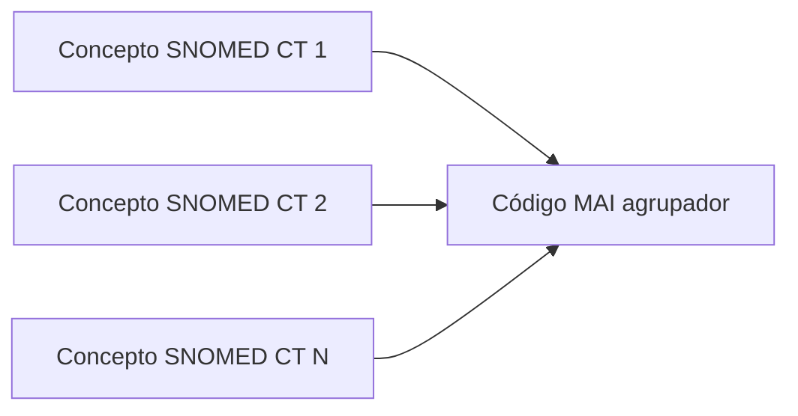
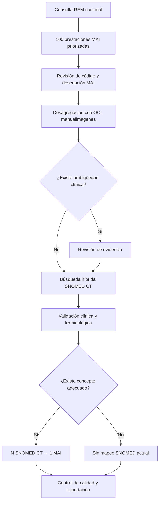

# Metodología de mapeo SNOMED CT → MAI

## Estado del documento

Documento metodológico vivo. Debe actualizarse cuando cambien la selección de prestaciones, los
criterios de validación, las ediciones terminológicas o la estructura del producto final.

## 1. Objetivo

Construir y validar un mapa que permita asociar procedimientos clínicos específicos representados en
SNOMED CT con prestaciones del Manual de Atención Institucional (MAI).

En este proyecto, el código MAI funciona como **agrupador administrativo de salida**. Por ello, el
modelo de mapeo definido es:

> **N conceptos SNOMED CT → 1 código MAI agrupador**

Cada registro individual del mapa contiene un concepto SNOMED CT de origen y un código MAI de destino.
Un mismo código MAI puede repetirse en varias filas porque puede agrupar varios procedimientos
SNOMED CT clínicamente diferentes.

Esta cardinalidad describe el producto de este proyecto. No implica que los conceptos SNOMED CT sean
sinónimos entre sí ni que el código MAI tenga exactamente el mismo significado clínico. Tampoco debe
interpretarse automáticamente como una equivalencia bidireccional o una regla de facturación.

## 2. Selección de las prestaciones MAI

Como primera etapa, se realizó una consulta a los Registros Estadísticos Mensuales (REM) para
identificar las **100 prestaciones MAI con mayor número de prestaciones realizadas a nivel nacional**.

La frecuencia nacional se utiliza como criterio de priorización: el trabajo comienza por las
prestaciones de mayor uso y, por tanto, de mayor impacto potencial para interoperabilidad y análisis.
La posición en el listado no determina la dificultad ni la calidad de un mapeo.

Para que la selección pueda reproducirse, el expediente metodológico debe registrar:

- serie, formulario, sección o tabla REM consultada;
- período utilizado y fecha de extracción;
- variable contabilizada como prestación realizada;
- cobertura territorial incluida;
- reglas de inclusión y exclusión;
- tratamiento de valores nulos, duplicados y empates;
- código y descripción MAI utilizados para enlazar los resultados;
- consulta, archivo o procedimiento con el que se obtuvo el orden de frecuencia.

Estos datos deben completarse con la consulta REM efectivamente utilizada; no deben reconstruirse de
memoria. El archivo de entrada debe conservarse con fecha, fuente y control de versión, respetando las
reglas institucionales de publicación de datos.

## 3. Unidad de análisis

La unidad inicial de trabajo es una prestación MAI priorizada. Como una prestación puede incluir más
de un examen, se desagrega en componentes clínicos antes de proponer códigos SNOMED CT.

Para cada prestación se conserva al menos:

- código MAI;
- descripción oficial MAI;
- posición o frecuencia obtenida desde REM;
- ID y nombre del examen utilizado para desambiguación en OCL `manualimagenes`;
- ConceptID y término preferido SNOMED CT;
- edición y fecha efectiva del RF2;
- estado del mapeo y responsable de la revisión;
- motivo de selección, referencias y observaciones;
- fecha de validación.

## 4. Flujo metodológico

### Etapa 1: revisar la prestación MAI

Confirmar que el código, la descripción y la frecuencia provienen de la misma versión del conjunto
MAI/REM. No modificar silenciosamente la descripción oficial; cualquier forma normalizada debe
guardarse en un campo separado.

### Etapa 2: desagregar con OCL

Consultar la fuente `MINSALQA/manualimagenes` para identificar los exámenes individuales comprendidos
en el texto MAI. OCL se utiliza para desambiguar y organizar componentes, no para establecer por sí
solo la equivalencia SNOMED CT–MAI.

### Etapa 3: resolver ambigüedades clínicas

Cuando existan dudas sobre modalidad, anatomía, contraste, proyección o alcance, revisar evidencia
clínica siguiendo el apartado de OpenEvidence de la
[guía de instalación y uso](05-guia-instalacion-y-uso-es.md#11-desambiguación-clínica-basada-en-evidencia-con-openevidence).
Las referencias originales revisadas deben quedar registradas.

### Etapa 4: obtener candidatos SNOMED CT

Abrir cada examen OCL seleccionado y ejecutar la búsqueda híbrida lexical/BioLORD. Las capas de
preprocesamiento, reranking y selección por LLM son ayudas opcionales; no confirman el mapeo.

### Etapa 5: validar el mapeo

Revisar para cada candidato:

- estado activo en la edición RF2 utilizada;
- jerarquía y etiqueta semántica apropiadas;
- método o modalidad;
- sitio anatómico y lateralidad;
- contraste, proyección, fases y otros atributos definitorios;
- nivel de especificidad respecto del examen desambiguado;
- ausencia de una mezcla indebida de métodos o sitios anatómicos.

Si varios procedimientos específicos pertenecen al mismo agrupador, cada ConceptID se registra en una
fila separada con el mismo código MAI. Si no existe un concepto adecuado, el componente se marca
**“Sin mapeo SNOMED actual”** y se conserva para revisión posterior.

### Etapa 6: control de calidad

Antes de liberar el mapa:

1. realizar una revisión clínica y terminológica independiente;
2. comprobar duplicados y ConceptID inactivos;
3. verificar que todas las filas conserven código MAI, evidencia y edición RF2;
4. revisar que la cardinalidad publicada sea SNOMED CT → MAI;
5. separar decisiones pendientes de los mapeos aprobados;
6. versionar y fechar el archivo resultante.

## 5. Interpretación de la relación

El mapa responde a la pregunta operativa:

> “¿A qué código MAI agrupador debe asociarse este procedimiento SNOMED CT dentro del alcance
> definido por el proyecto?”

No responde, sin reglas adicionales, a preguntas como:

- “¿Qué procedimiento clínico exacto se realizó sólo porque existe este código MAI?”
- “¿Todos los conceptos agrupados son clínicamente equivalentes?”
- “¿La relación puede utilizarse automáticamente para facturar o autorizar una prestación?”

La dirección inversa, MAI → SNOMED CT, devuelve potencialmente varios procedimientos y debe tratarse
como una expansión del agrupador, no como una selección clínica automática.

## 6. Decisiones metodológicas pendientes de completar

Para cerrar la primera versión formal de la metodología se debe incorporar:

- período exacto y consulta REM utilizada;
- definición del denominador y del conteo nacional;
- criterios ante empates en la posición 100;
- versión del arancel o catálogo MAI;
- edición International y edición española de SNOMED CT;
- criterios formales de aceptación y rechazo;
- número y perfil de revisores;
- procedimiento de resolución de desacuerdos;
- indicadores de cobertura, concordancia y calidad;
- periodicidad de actualización del mapa.

## 7. Registro de versiones metodológicas

| Versión | Cambio |
|---|---|
| 0.1 | Se documenta la selección inicial de 100 prestaciones desde REM y la cardinalidad N SNOMED CT → 1 MAI agrupador. |
